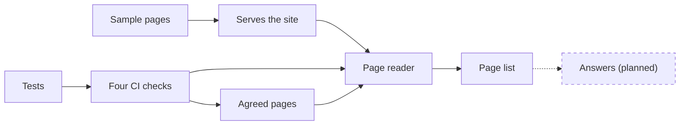

# Maple Street Front Desk

A front-desk assistant for Maple Street that answers your customers' questions only from your own pages. This is a demo, with a fictional sample site.

## What works now

- A [sample site](sample-site/) of six pages.
- The page reader and the page list. See [How your pages are read](docs/behaviour.md#how-your-pages-are-read).
- Four automatic checks. See [How the checks prove it](docs/behaviour.md#how-the-checks-prove-it).

## How it fits together

The page reader takes your agreed page list, fetches those pages from the sample site, and prints a page list, while four checks test the reader and your agreements.

## What's planned

- [Agree on the 15 test questions and the urgent words](https://github.com/RoxanaTapia/maple-street-front-desk/issues/3)
- [Urgent messages get a fixed reply with your main line](https://github.com/RoxanaTapia/maple-street-front-desk/issues/4)
- [Never give a price that isn't on your pages](https://github.com/RoxanaTapia/maple-street-front-desk/issues/5)
- [Demo link and handover](https://github.com/RoxanaTapia/maple-street-front-desk/issues/6)
- Answers from your pages, in a later step.

## Try it

1. In Cursor, open the project and a terminal (``Ctrl+` ``, or `Cmd+J` on a Mac).
2. Run `python3 scripts/serve_sample_site.py` and open the address it prints.
3. In a second terminal, run `python3 scripts/read_pages.py`.

Stop with `Ctrl+C`.

## Where things are

- [What you've agreed](docs/agreements.md)
- [How the assistant behaves](docs/behaviour.md)
- `tests/`
- [AGENTS.md](AGENTS.md), the briefing agents read first.
