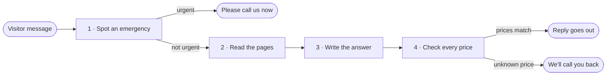

# Maple Street Front Desk

> An AI front desk that answers from the business pages, and only states a price when those pages do.

[](https://github.com/RoxanaTapia/maple-street-front-desk/actions/workflows/ci.yml)
[](LICENSE)
[](https://front-desk.roxanatapia.dev/)

🟢 **Live demo:** [front-desk.roxanatapia.dev](https://front-desk.roxanatapia.dev/)
▶ **Watch the demo:** [YouTube](https://youtu.be/pK46NvuIJOg)
📄 **The case:** [Saturday night, burst pipe](https://roxanatapia.dev/cases/front-desk/)

[](https://youtu.be/pK46NvuIJOg)

## The case

This is a demo for Maple Street Plumbing, a fictional plumbing business. A burst pipe on Saturday night must not get a guessed price. An urgent message gets a reply to call the business right away. Any other answer comes only from the business's own pages, and a price appears only when those pages state it.

The assistant reads a copy of that fictional business's site. It does not change the website.

## What it does

- 🚨 An urgent message gets a fixed reply to call the business right away
- 💲 A price is kept only when the pages state it near the service asked about
- 📚 Answers come only from the business pages
- 💬 A demo chat you can try from the live link, or on your computer

What a visitor gets back:

| A visitor writes | What they get |
|---|---|
| "I have a burst pipe" | A message to call the business right away |
| "How much is a water heater replacement?" | An offer of a callback, since that price is not on the pages |
| "Do you sell pizza?" | A reply that points them back to plumbing |
| "Are you open Saturdays?" | A short answer from the Hours & FAQ page |
| "Do you clean drains?" | A short yes from the Pricing page, with the price written there |
| "How much is a drane cleaning?" (as typed) | The drain cleaning price from the Pricing page |
| "Is drain cleaning 149?" | A short yes that names the price on the Pricing page |

What each kind of message gets back is in [How the assistant behaves](docs/behaviour.md).

## How it works



An emergency is caught first. A price is checked last. A number the pages do not state, or a price for a different service, does not go out.

The public chat allows 200 messages a day to reach the AI, and 20 from one visitor. The day runs from midnight to midnight in Berlin. When a cap is reached, the visitor gets a short note to come back tomorrow or book a call on [roxanatapia.dev](https://roxanatapia.dev), and the AI is not called. An urgent message still gets the fixed reply to call the business. A question the assistant answers without the AI does not use up the count. The count is kept in memory, so a restart starts it again.

## For engineers

### Stack

Python 3.12 and Claude. The programs use Python's own library, so there is nothing else to install for a local demo. Without a key, a stand-in answers the agreed test questions. That stand-in is not the AI.

The sample site has six pages: home, services, pricing, hours, service area, and contact.

`CHAT_DAILY_LIMIT` and `CHAT_VISITOR_DAILY_LIMIT` change the caps, and the names sit in [.env.example](.env.example).

### Quickstart

```bash
git clone https://github.com/RoxanaTapia/maple-street-front-desk.git
cd maple-street-front-desk
python3 scripts/demo_chat.py
```

It prints `Demo chat at http://127.0.0.1:8080`. Open that address. The page opens with a greeting and four messages you can send, and you can still type your own. The practice site starts with the chat, so there is nothing else to run. Stop it with Ctrl+C.

To use Claude, set `ANTHROPIC_API_KEY` in the environment first (see [.env.example](.env.example)). If port 8080 is already in use, set `DEMO_PORT` to another port.

Setup and install notes: [setup guide](docs/setup-guide.md) and [developer guide](docs/developer-guide.md).

### Automated tests

```bash
python3 scripts/run_checks.py
ruff check .
ruff format --check .
```

GitHub Actions runs the automated tests on every pull request and every push to main ([`.github/workflows/ci.yml`](.github/workflows/ci.yml)). The automated tests cover the agreed test questions, the urgent words, and the price rules. Commands: [AGENTS.md](AGENTS.md).

### Project structure

| Path | What you find |
|------|----------------|
| [`demo/`](demo/) | The chat page you open in the browser |
| [`sample-site/`](sample-site/) | The six business pages the assistant reads |
| [`scripts/`](scripts/) | The demo server and the answer logic |
| [`tests/`](tests/) | Automated tests |
| [`docs/`](docs/) | Behaviour, agreements, setup, and handover |

Take a closer look:

- [What we've agreed](docs/agreements.md): the pages, the urgent words, the contact details, and the agreed test questions
- [How the assistant behaves](docs/behaviour.md): what a visitor gets back
- [How the assistant works](docs/how-it-works.md): the path of a message, and how to try the sample site
- [Setup guide](docs/setup-guide.md) and [developer guide](docs/developer-guide.md)
- [Handover notes](docs/handover.md): what you have, and how to change it yourself
- [Live test results](docs/test-results.md): a recorded run against the agreed questions

### How I build

I build with AI coding agents. Every change goes through a pull request I review and merge, with automated tests you can see on every change.

---

[MIT License](LICENSE) · [Roxana Tapia](https://github.com/RoxanaTapia) · [roxanatapia.dev](https://roxanatapia.dev)
