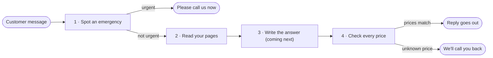

# Maple Street Front Desk

Maple Street Front Desk is an AI front-desk assistant for a small plumbing business. It answers customer questions only from the business's own pages, sends urgent problems straight to the phone, and never invents a price.

**A front desk that answers from the business's own pages, sends urgent callers straight to the phone, and never quotes a price the business has not published.**

For now it works on a small practice copy of the business's site, so nothing touches the real one.

## What customers get

| A customer writes | What they get | Ready? |
|---|---|---|
| "I have a burst pipe" | A message to call the owner right away, with the business number | ✅ |
| "How much is a water heater replacement?" | An offer of a callback, since that price isn't on the business's pages | ✅ |
| "Are you open Saturdays?" | A short answer from the Hours & FAQ page | ⏳ |

Once answers are in place, every answer will come from the business's published pages. If those pages don't say, the assistant says so instead of guessing. What each kind of message gets back is in [How your assistant behaves](docs/behaviour.md).

## How a message is handled

Emergencies are caught first, so an urgent caller never waits for a written answer. Every reply is checked for prices last, so nothing goes out with a number the business has not published.

## Where we are

- ✅ **Reads the pages:** all six, with the words a visitor actually sees.
- ✅ **Spots emergencies:** the urgent words agreed with the client get the fixed reply, right away.
- ✅ **Guards every price:** an amount that isn't on the business's pages is swapped for the callback reply.
- ⏳ **Writes the answer:** a short reply from your pages.
- ⏳ **Demo link and handover:** a link to try, then a simple guide for running it.

## Built with AI, checked by people

The assistant is built with the help of AI agents, each with a clear job, and every change is checked before it counts.

- **A team with clear roles:** one AI agent plans each change, another writes the checks, and another keeps these pages clear and up to date.
- **One change at a time:** each change starts as a written request and arrives with a plain-English summary of what it does and why.
- **The promises are tested every time:** each of the 15 agreed questions has a plan, and the urgent and price rules are tested on every change. If anything agreed would break, the change stops.
- **A person signs off:** nothing is added until that sign-off is done.

## Take a closer look

- [What we've agreed](docs/agreements.md): the business's pages, urgent words, contact details and the 15 test questions.
- [How your assistant behaves](docs/behaviour.md): what customers will experience.
- [How the assistant works](docs/how-it-works.md): how a message is handled, and how to try the sample site.

**Next up:** the answer step, then a demo link to try.
