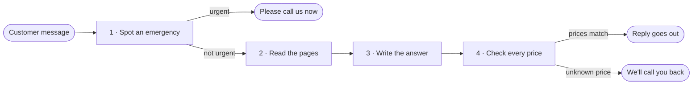

# Maple Street Front Desk

Maple Street Front Desk is an AI front-desk assistant for a small plumbing business. It answers customer questions only from the business's own pages, tells customers with an urgent problem to call right away, with the business number, and never invents a price.

For now it runs on a small practice copy of the business's site. The real site stays untouched.

## What customers get

| A customer writes | What they get | Ready? |
|---|---|---|
| "I have a burst pipe" | A message to call the owner right away, with the business number | ✅ |
| "How much is a water heater replacement?" | An offer of a callback, since that price isn't on the business's pages | ✅ |
| "Are you open Saturdays?" | A short answer from the Hours & FAQ page | ✅ |

What each kind of message gets back is in [How the assistant behaves](docs/behaviour.md).

## How a message is handled

An emergency is caught first. A price is checked last, and an unpublished number does not go out.

## Where we are

- ✅ **Reads the pages:** all six, with the words a visitor actually sees.
- ✅ **Spots emergencies:** the urgent words get the fixed reply, right away.
- ✅ **Guards every price:** an amount that isn't on the business's pages is swapped for the callback reply.
- ✅ **Writes the answer:** a short reply from the business's pages.
- ✅ **Demo chat:** a page to try the same replies, from a link.
- ⏳ **Handover:** a simple guide for running it.

## Built with AI, checked by people

- **Clear roles.** One agent plans a change, another writes the checks, and another keeps these pages up to date.
- **One change at a time.** Each change starts as a written request, with a plain-English summary.
- **Promises are tested.** The 15 agreed questions, the urgent words, and the price rules are tested on every change.
- **A person signs off.** Nothing is added until that sign-off is done.

## Take a closer look

- [What we've agreed](docs/agreements.md): the pages, the urgent words, the contact details, and the 15 test questions.
- [How the assistant behaves](docs/behaviour.md): what a customer gets back.
- [How the assistant works](docs/how-it-works.md): the path of a message, and how to try the sample site.

**Next up:** handover notes.
