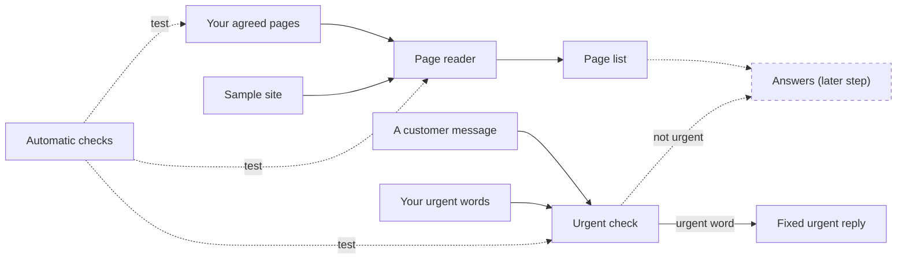

# Maple Street Front Desk

A front-desk assistant for Maple Street that answers your customers' questions only from your own pages. It gives urgent messages your main line right away and will never quote a price you haven't published. For now it runs on a fictional sample site.

## What works now

- A [sample site](sample-site/) of six pages, including a readable Pricing page.
- The page reader and the page list. See [How your pages are read](docs/behaviour.md#how-your-pages-are-read).
- Urgent messages get the fixed reply before any answer. See [How it works](docs/behaviour.md#how-it-works).
- Five automatic checks. See [How the checks prove it](docs/behaviour.md#how-the-checks-prove-it).

## How it fits together

The page reader reads your agreed pages from the site and shows which ones it found. An urgent message is checked first and gets the fixed reply, without reading your pages. Automatic checks test this on every change.

## What's planned

- Answers from your pages, in a later step. The drain-cleaning question will be answered from Pricing.
- [Agree on the 15 test questions and the urgent words](https://github.com/RoxanaTapia/maple-street-front-desk/issues/3), Sat Oct 31
- [Never give a price that isn't on your pages](https://github.com/RoxanaTapia/maple-street-front-desk/issues/5), Mon Nov 2
- [Demo link and handover](https://github.com/RoxanaTapia/maple-street-front-desk/issues/6), Tue Nov 3 and Wed Nov 4

## Try it

1. In Cursor, open the project and a terminal (``Ctrl+` `` or `Cmd+J` on a Mac). You need Python 3.
2. Run `python3 scripts/serve_sample_site.py` and open the address it prints.
3. In a second terminal, run `python3 scripts/read_pages.py`. Every page is listed as read.
4. Try an urgent message: `python3 scripts/urgent_reply.py "I have a burst pipe"` and look for the fixed urgent reply.
5. Try a normal question: `python3 scripts/urgent_reply.py "Are you open Saturdays?"` and see that it is not treated as urgent.

Stop the site with `Ctrl+C`.

## Where things are

- [What you've agreed](docs/agreements.md)
- [How the assistant behaves](docs/behaviour.md)
- [tests/](tests/): the automatic checks
- [AGENTS.md](AGENTS.md): how this project is built and changed
- [How your assistant gets built](https://github.com/RoxanaTapia/maple-street-front-desk/issues/1)
