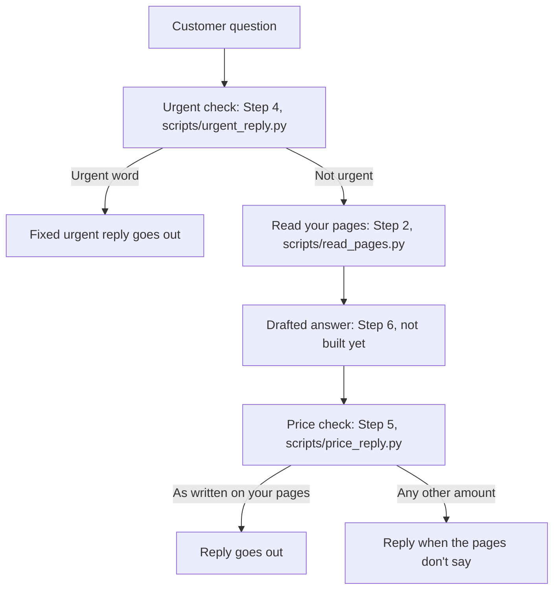

# How the whole system works

## The whole flow



An urgent word stops there: the customer gets only the fixed urgent reply, and your pages are not read. Any other question is read from your pages, drafted into an answer (that draft is not built yet), checked so every price matches your pages, and only then sent.

## The urgent check

Step 4, in [scripts/urgent_reply.py](../scripts/urgent_reply.py).

It checks a customer message for the urgent words in [Urgent messages](agreements.md#urgent-messages). When one of those words is there, the reply is only the fixed reply from that same place.

The risk is an emergency getting an ordinary answer, or your pages being read when the customer should just call.

What goes in is the message. What comes out is the fixed reply, or a line that says the message is not urgent.

```
python3 scripts/urgent_reply.py 'I have a burst pipe'
```

You should see: This sounds urgent. Please call us now on (856) 555-0142.

```
python3 scripts/urgent_reply.py 'Are you open Saturdays?'
```

You should see: This message is not urgent.

The check that covers this is **Urgent messages get the fixed reply**.

## Reading your pages

Step 2, in [scripts/read_pages.py](../scripts/read_pages.py).

It opens the six pages named in [Your pages](agreements.md#your-pages) and keeps the title and the words a customer can see. Code and styling are left out. The list shows the name, the title, the address, and whether the page was read. A page that cannot be opened stays on the list as unreadable, with the reason.

The risk is a failed page disappearing, or hidden code being treated as something you published.

What goes in is your running sample site. What comes out is that page list.

Start the sample site and leave it running. It prints where to open it. Stop it later with Ctrl+C.

```
python3 scripts/serve_sample_site.py
```

In a second terminal, read the pages. With no address, this uses the sample site you just started.

```
python3 scripts/read_pages.py
```

You should see a page list of all six pages. Each one shows its title, its address, and Status: read. The titles are Home | Maple Street, Services | Maple Street, Pricing | Maple Street, Service Area | Maple Street, Hours & FAQ | Maple Street, and Contact | Maple Street.

The check that covers this is **Your pages are read**.

## The price check

Step 5, in [scripts/price_reply.py](../scripts/price_reply.py).

It reads your pages and looks through an answer for money amounts. An amount stays only when a page writes it the same way. A longer amount is read whole, so it cannot pass as a shorter price. Any other amount replaces the whole answer with the callback reply in [When the pages don't say](agreements.md#when-the-pages-dont-say). An answer with no amount stays as it is.

The risk is a price you never published reaching a customer.

What goes in is an answer you type (what the assistant would say), because the drafted answer is not built yet. The sample site from the section above needs to be running. What comes out is that answer, or the callback reply.

```
python3 scripts/price_reply.py 'A drain cleaning is $149.'
```

You should see: A drain cleaning is $149.

```
python3 scripts/price_reply.py 'The call-out fee is 99 dollars.'
```

You should see: I can't confirm that from your pages.

The first stays, because your Pricing page writes a drain cleaning as $149. The second becomes the callback reply, because your Services page writes the call-out fee as $99.

The checks that cover this are **Prices come only from your pages** and **A longer price isn't mistaken for a shorter one**.

## Not built yet

- Step 6 writes the drafted answer from your pages, names the page it came from, and uses the callback reply when the pages don't cover the question.
- Step 6 still has to match a price to the right service.
- "99 dollars" and "$149.00" get the callback reply for now, and "250 bucks" is not read as a price yet. Step 6 covers those wordings.
- Step 3 is waiting on your OK for the 15 test questions and the urgent words. They are already written in [What we've agreed](agreements.md).
- Step 7 is a demo link you can try, then a setup guide and handover notes so you can run it yourself.
