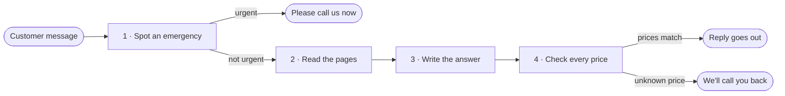

# How the assistant works

The assistant checks a message for an emergency, answers from the business's pages, and sends the reply only when every price matches those pages and belongs to the service the customer asked about.

The urgent reply, the two call-us sentences, the off-topic reply, and the 18 test questions are read from [What we've agreed](agreements.md). `scripts/agreed.py` is the one reader the other scripts use.



| | What happens | Script | Ready? |
|---|---|---|---|
| 1 | Spot an emergency | `scripts/urgent_reply.py` | Yes |
| 2 | Read the pages | `scripts/read_pages.py` | Yes |
| 3 | Write the answer | `scripts/answer_reply.py` | Yes |
| 4 | Check every price | `scripts/price_reply.py` | Yes |

`scripts/front_desk.py` runs these four parts in order. Start the sample site first. [Try it yourself](#try-it-yourself) is at the end.

## 1 · Spot an emergency

*An urgent problem gets a reply that tells the customer to call right away, with the business number, not a paragraph about opening hours.*

**What it does**

- Reads the urgent words and the fixed reply in [Urgent messages](agreements.md#urgent-messages).
- When one of those words is present, the customer gets only that reply. The pages are not read.
- A spelling named beside a word counts as that word. Leaking counts. "I have a leaky faucet" does not, and neither does a plural such as "frozen pipes".

**Try it**

```
python3 scripts/urgent_reply.py 'I have a burst pipe'
python3 scripts/urgent_reply.py 'The pipe is leaking'
python3 scripts/urgent_reply.py 'I have a leaky faucet'
python3 scripts/urgent_reply.py 'Are you open Saturdays?'
```

| Message | What you get |
|---|---|
| I have a burst pipe | The fixed urgent reply |
| The pipe is leaking | The fixed urgent reply |
| I have a leaky faucet | `This message is not urgent.` |
| Are you open Saturdays? | `This message is not urgent.` |

The phone number in the fixed urgent reply is not a price.

## 2 · Read the pages

*An answer can only use what the business has published.*

**What it does**

- Reads the six pages listed in [What we've agreed](agreements.md#your-pages).
- Opens each one over the web and keeps the title and the words a visitor can see. Code and styling are left out.
- A page that can't be opened stays on the list as unreadable, with the reason. The others are still read. That page is also noted for the owner. The note is described with the answer, below.

**Try it**

```
python3 scripts/read_pages.py
```

1. `Page list`, then Home, Services, Pricing, Service Area, Hours & FAQ, and Contact.
2. Each page has `Status: read`.
3. The titles are Home | Maple Street, Services | Maple Street, Pricing | Maple Street, Service Area | Maple Street, Hours & FAQ | Maple Street, and Contact | Maple Street.

Every sample page shows a banner that this business is fictional.

## 3 · Write the answer

*A question gets a short answer from the business's pages, the off-topic reply when it is clearly about something else, the callback reply when the pages don't cover it, or the outage reply when the call fails.*

**What it does**

- A question the pages answer gets a short answer that names the page.
- A service with a price on the pages gets a yes, that price, and the page name. "Do you clean drains?" is that case.
- A small misspelling of a service the pages list, such as drane for drain, gets that service's answer in plain words.
- A price written without a dollar sign, when it matches the pages, gets a short yes spoken to the customer.
- A question that is clearly about something else gets the off-topic reply from [Off-topic questions](agreements.md#off-topic-questions). Anything else the pages don't cover gets the call-us reply from [When the pages don't say](agreements.md#when-the-pages-dont-say).
- If the call fails, the customer gets the outage reply from [When the assistant can't look it up](agreements.md#when-the-assistant-cant-look-it-up). A short note is kept for the owner.
- A page that can't be read is written to those same notes. The line has the time, the page name, and the kind of error. The customer's message is not included. The same page is written once an hour. Where to read the notes is in the [handover notes](handover.md#your-error-notes) and the [setup guide](setup-guide.md#questions).
- The 18 questions in [The 18 test questions](agreements.md#the-18-test-questions) each name a page, use the fixed urgent reply, or offer a callback.

**Try it**

*The first command is this step alone. The others run the whole path. These use no key, so the stand-in answers.*

```
python3 scripts/answer_reply.py 'Are you open Saturdays?'
python3 scripts/front_desk.py 'How much is a drain cleaning?'
python3 scripts/front_desk.py 'How much is a drane cleaning?'
python3 scripts/front_desk.py 'Is drain cleaning 149?'
python3 scripts/front_desk.py 'Do you clean drains?'
python3 scripts/front_desk.py 'Do you cover Moorestown?'
python3 scripts/front_desk.py 'Do you sell pizza?'
python3 scripts/front_desk.py 'I have a burst pipe'
```

| Message | What you get |
|---|---|
| Are you open Saturdays? | `Saturday: 8:00 am to 12:00 pm. Yes, we are open Saturdays. From Hours & FAQ.` |
| How much is a drain cleaning? | `A drain cleaning is $149. From Pricing.` |
| How much is a drane cleaning? | `A drain cleaning is $149. From Pricing.` |
| Is drain cleaning 149? | `Yes, a drain cleaning is $149. From Pricing.` |
| Do you clean drains? | `Yes, we do drain cleaning. It's $149. From Pricing.` |
| Do you cover Moorestown? | The callback reply |
| Do you sell pizza? | The off-topic reply |
| I have a burst pipe | The fixed urgent reply |

*With a key, Claude writes the answer. The value below is not a real key. The names are listed in [.env.example](../.env.example).*

```
export ANTHROPIC_API_KEY='...'
python3 scripts/answer_reply.py 'Are you open Saturdays?'
```

The answer is short and names the page. `CLAUDE_MODEL` is optional, and the default is set in the code.

To see the note for a page that can't be opened, set `pricing_live = False` in `scripts/serve_sample_site.py`, run `python3 scripts/demo_chat.py`, ask a question, then read `logs/error-notes.log`. Set `pricing_live` back to `True` afterwards. Asking again within the hour does not add another line for that page.

## 4 · Check every price

*A price goes out only when the business's pages state that amount, on the same page and near the service the customer asked about.*

**What it does**

- A price is kept only as the pages write it, and only when it sits near that service on the same page. A plural, an -ing form, or a small misspelling still counts, so drane matches drain.
- A number written as 150, or as 150 dollars, is still a price. A wrong amount is replaced with the callback reply.
- An answer with no amount is left as it is. An address is not a price. An urgent message is still handled first.
- Pass what the customer asked with `--asked`. Without it, the check only confirms that the amount is written on the pages.

**Try it**

```
python3 scripts/price_reply.py 'A drain cleaning is $149.'
python3 scripts/price_reply.py --asked 'How much is a drain cleaning?' 'A drain cleaning is $149.'
python3 scripts/price_reply.py --asked 'How much is a drain cleaning?' 'The call-out fee is $99.'
python3 scripts/price_reply.py --asked 'How much is a drain cleaning?' 'A drain cleaning is 150.'
python3 scripts/price_reply.py 'A water heater replacement is $1,200.'
```

| Answer | What you get |
|---|---|
| A drain cleaning is $149. | `A drain cleaning is $149.` |
| A drain cleaning is $149, asked about a drain cleaning. | `A drain cleaning is $149.` |
| The call-out fee is $99, asked about a drain cleaning. | The callback reply |
| A drain cleaning is 150, asked about a drain cleaning. | The callback reply |
| A water heater replacement is $1,200. | The callback reply |

## Try it yourself

Python 3 is enough. From the project folder:

```
python3 scripts/serve_sample_site.py
```

It prints `Serving the sample site at http://127.0.0.1:8000`. Open that address. If the port is already in use, it prints `The sample site is already running on port 8000. Stop it with Ctrl+C, or start on another port with --port.` Leave the site running, and use a second terminal for the commands. Stop the site with Ctrl+C.

Use single quotes when a message contains a dollar sign, so the shell keeps the amount.

Run every check with one command:

```
python3 scripts/run_checks.py
```

Each check prints ok, and the run ends with OK. The same checks run on every pull request.

<details>
<summary>Run one area</summary>

- `python3 scripts/run_checks.py tests/test_checks.py`
- `python3 scripts/run_checks.py tests/test_links.py`
- Pages are read
- The test questions
- A priced service is offered
- A misspelling and a plain price
- Urgent words
- Prices
- Answers
- A failed call is noted
- A failed call gets the outage reply
- A page that can't be read is noted
- Off-topic questions
- The demo chat

</details>

## Try the demo

A chat page runs the same steps as the command line. From the project folder:

```
python3 scripts/demo_chat.py
```

It prints `Demo chat at http://127.0.0.1:8080`. Open that address. The page says: This is a demo. It answers only from Maple Street's pages. Type a message and the reply comes back. The sample site starts with it, so there is nothing else to run. Stop it with Ctrl+C.

`DEMO_HOST` and `DEMO_PORT` choose the address. The default is local. The names are listed in [.env.example](../.env.example). The Claude key is set on the machine that runs the assistant. It isn't written into the repo or shown in replies. A crash, a blank reply, or a reply that would show the key is replaced with the outage reply. A clearly unrelated question gets the off-topic reply. A missing fact, and a price the pages don't state, stay the callback reply.
