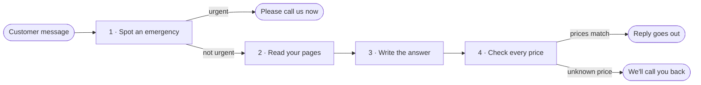

# How the assistant works

This page follows one customer message from the moment it arrives to the moment a reply goes out. It's for anyone who wants to understand the system before reading the code, or to check that each part behaves the way the code says. The [README](../README.md) gives the short overview; this is the closer look.

## The journey of a message

Every message takes the same path, in this order:



| | What happens | Script | Ready? |
|---|---|---|---|
| 1 | Spot an emergency | `scripts/urgent_reply.py` | Yes |
| 2 | Read your pages | `scripts/read_pages.py` | Yes |
| 3 | Write the answer | `scripts/answer_reply.py` | Shared parts |
| 4 | Check every price | `scripts/price_reply.py` | Yes |

An emergency stops at the first stop: the customer is told to call, and nothing else runs. Every other message is answered from your pages, and the answer only goes out once every price in it matches what you've published. One command, `scripts/front_desk.py`, runs that whole path.

## Before you try the commands

Parts 2, 3, and 4 read a sample copy of your site. Start it once in its own terminal and leave it running (Ctrl+C stops it):

```
python3 scripts/serve_sample_site.py
```

Then run the commands below in a second terminal.

## 1 · Spot an emergency

A burst pipe shouldn't get a friendly paragraph about opening hours. This part looks for the urgent words we agreed in [Urgent messages](agreements.md#urgent-messages). If it finds one, the customer gets the fixed urgent reply straight away, and your pages are never read.

```
python3 scripts/urgent_reply.py 'I have a burst pipe'
python3 scripts/urgent_reply.py 'Are you open Saturdays?'
```

You'll see:

1. `This sounds urgent. Please call us now on (856) 555-0142.`
2. `This message is not urgent.`

Tested by **Urgent messages get the fixed reply**.

## 2 · Read your pages

The assistant can only answer from what you've published, so it first reads the six pages listed in [Your pages](agreements.md#your-pages). It keeps each title and the words a visitor can see, and leaves out code and styling. If a page can't be opened, it stays on the list marked unreadable, with the reason, so a broken page never quietly disappears.

```
python3 scripts/read_pages.py
```

You'll see all six pages, each with `Status: read`: Home, Services, Pricing, Service Area, Hours & FAQ and Contact.

Tested by **Your pages are read**.

## 3 · Write the answer

A question should get a short answer from your pages, not a guess. This part names the page the answer came from. When your pages don't cover the question, it uses the callback reply from [When the pages don't say](agreements.md#when-the-pages-dont-say).

The instructions for that answer are built now. They say to answer only from these pages, keep it short, name the page, and use that callback sentence when the pages don't cover the question. The text of all six pages is included. `scripts/front_desk.py` runs the four parts in order: the urgent reply, then your pages, then this answer, then the price check. The real AI call waits until you choose the setup. Until then, the checks use a stand-in that answers the agreed test questions. It is not a real AI.

```
python3 scripts/answer_reply.py 'Are you open Saturdays?'
python3 scripts/front_desk.py 'How much is a drain cleaning?'
python3 scripts/front_desk.py 'Do you cover Moorestown?'
python3 scripts/front_desk.py 'I have a burst pipe'
```

You'll see:

1. `Saturday: 8:00 am to 12:00 pm. Yes, we are open Saturdays. From Hours & FAQ.`
2. `A drain cleaning is $149. From Pricing.`
3. `I can't confirm that from your pages.`
4. `This sounds urgent. Please call us now on (856) 555-0142.`

Tested by **Answers come from your pages**.

## 4 · Check every price

The AI could make up a price, so every answer is checked before it goes out. Each money amount must appear on your pages exactly as written. If even one doesn't, the whole answer is replaced with the callback reply. A longer number is read in full, so $1499 can never pass as $149.

The whole path runs this check after the answer is written. You can still try one answer on its own:

```
python3 scripts/price_reply.py 'A drain cleaning is $149.'
python3 scripts/price_reply.py 'The call-out fee is 99 dollars.'
```

You'll see:

1. `A drain cleaning is $149.` It's unchanged, because your Pricing page says $149.
2. `I can't confirm that from your pages.` Your Services page writes the fee as $99, and "99 dollars" doesn't match it exactly.

Tested by **Prices come only from your pages** and **A longer price isn't mistaken for a shorter one**.

## Still to come

- **The real AI call**, once you choose the setup. The instructions, the page name, the callback, and the path a message takes are already in place.
- **Matching each price to the right service.** A published amount is kept. The check does not yet confirm that the amount belongs to the service in the question.
- **More ways of writing prices.** Today "99 dollars" and "$149.00" get the callback reply, and "250 bucks" isn't read as a price.
- **Your OK on the 15 test questions and urgent words**, already written in [What we've agreed](agreements.md).
- **A demo link you can try**, then a setup guide and handover notes so you can run it yourself.
