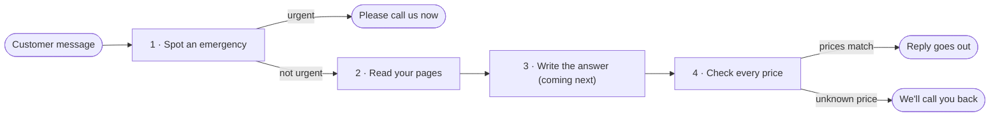

# How the assistant works

This page follows one customer message from the moment it arrives to the moment a reply goes out. It's for anyone who wants to understand the system before reading the code, or to check that each part behaves the way the code says. The [README](../README.md) gives the short overview; this is the closer look.

## The journey of a message

Every message takes the same path, in this order:



| | What happens | Script | Ready? |
|---|---|---|---|
| 1 | Spot an emergency | `scripts/urgent_reply.py` | Yes |
| 2 | Read your pages | `scripts/read_pages.py` | Yes |
| 3 | Write the answer | not written yet | Coming next |
| 4 | Check every price | `scripts/price_reply.py` | Yes |

An emergency stops at the first stop: the customer is told to call, and nothing else runs. Every other message is answered from your pages, and the answer only goes out once every price in it matches what you've published.

## Before you try the commands

Parts 2 and 4 read a sample copy of your site. Start it once in its own terminal and leave it running (Ctrl+C stops it):

```
python3 scripts/serve_sample_site.py
```

Then run the commands below in a second terminal.

## 1 · Spot an emergency

A burst pipe shouldn't get a friendly paragraph about opening hours. This part looks for the urgent words we agreed in [Urgent messages](agreements.md#urgent-messages). If it finds one, the customer gets the fixed urgent reply straight away, and your pages are never read.

```
python3 scripts/urgent_reply.py 'I have a burst pipe'
python3 scripts/urgent_reply.py 'Are you open Saturdays?'
```

You'll see:

1. `This sounds urgent. Please call us now on (856) 555-0142.`
2. `This message is not urgent.`

Tested by **Urgent messages get the fixed reply**.

## 2 · Read your pages

The assistant can only answer from what you've published, so it first reads the six pages listed in [Your pages](agreements.md#your-pages). It keeps each title and the words a visitor can see, and leaves out code and styling. If a page can't be opened, it stays on the list marked unreadable, with the reason, so a broken page never quietly disappears.

```
python3 scripts/read_pages.py
```

You'll see all six pages, each with `Status: read`: Home, Services, Pricing, Service Area, Hours & FAQ and Contact.

Tested by **Your pages are read**.

## 3 · Write the answer

This is the next part to be built. It will write a short answer from your pages, name the page it came from, and fall back to the callback reply from [When the pages don't say](agreements.md#when-the-pages-dont-say) when your pages don't cover the question.

## 4 · Check every price

The AI could make up a price, so every answer is checked before it goes out. Each money amount must appear on your pages exactly as written. If even one doesn't, the whole answer is replaced with the callback reply. A longer number is read in full, so $1499 can never pass as $149.

Until part 3 exists, you type the answer yourself, the way the assistant would say it:

```
python3 scripts/price_reply.py 'A drain cleaning is $149.'
python3 scripts/price_reply.py 'The call-out fee is 99 dollars.'
```

You'll see:

1. `A drain cleaning is $149.` It's unchanged, because your Pricing page says $149.
2. `I can't confirm that from your pages.` Your Services page writes the fee as $99, and "99 dollars" doesn't match it exactly.

Tested by **Prices come only from your pages** and **A longer price isn't mistaken for a shorter one**.

## Still to come

- **Writing the answer** (part 3), including matching each price to the right service.
- **More ways of writing prices.** Today "99 dollars" and "$149.00" get the callback reply, and "250 bucks" isn't read as a price.
- **Your OK on the 15 test questions and urgent words**, already written in [What we've agreed](agreements.md).
- **A demo link you can try**, then a setup guide and handover notes so you can run it yourself.
