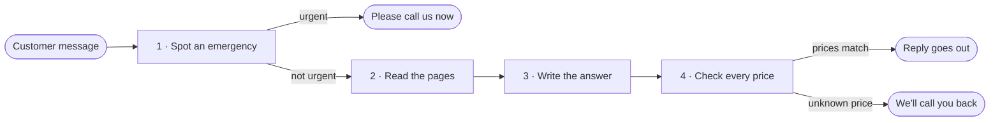

# How the assistant works

The assistant checks a message for an emergency, answers from the business's pages, and sends the reply only when every price matches those pages and belongs to the service the customer asked about.



| | What happens | Script | Ready? |
|---|---|---|---|
| 1 | Spot an emergency | `scripts/urgent_reply.py` | Yes |
| 2 | Read the pages | `scripts/read_pages.py` | Yes |
| 3 | Write the answer | `scripts/answer_reply.py` | Yes |
| 4 | Check every price | `scripts/price_reply.py` | Yes |

`scripts/front_desk.py` runs these four parts in order. Start the sample site first. [Try it yourself](#try-it-yourself) is at the end.

## 1 · Spot an emergency

*An urgent problem gets a reply that tells the customer to call right away, with the business number, not a paragraph about opening hours.*

**What it does**

- Reads the urgent words in [Urgent messages](agreements.md#urgent-messages), and the reply that goes with them.
- When one of those words is present, the customer gets only the fixed urgent reply. The pages are not read.
- A frozen pipe is one of those words, so a message such as "I think I have a frozen pipe" gets only the fixed urgent reply.
- Water everywhere, a basement, and a leak are urgent words too. "My basement has water everywhere" gets only the fixed urgent reply.
- A spelling named beside a word counts as that word. Leak also covers leaking, so "The pipe is leaking" gets only the fixed urgent reply.
- "I have a leaky faucet" does not use an urgent word, so it is left for the next part.
- A normal question is left for the next part.
- A question about after-hours emergency callouts is not urgent. It uses none of the urgent words, so the pages are read and the Hours & FAQ page answers it.

**Try it**

```
python3 scripts/urgent_reply.py 'I have a burst pipe'
python3 scripts/urgent_reply.py 'My basement has water everywhere'
python3 scripts/urgent_reply.py 'The pipe is leaking'
python3 scripts/urgent_reply.py 'I have a leaky faucet'
python3 scripts/urgent_reply.py 'Are you open Saturdays?'
```

| Message | What you get |
|---|---|
| I have a burst pipe | The fixed urgent reply |
| My basement has water everywhere | The fixed urgent reply |
| The pipe is leaking | The fixed urgent reply |
| I have a leaky faucet | `This message is not urgent.` |
| Are you open Saturdays? | `This message is not urgent.` |

*Good to know.* The phone number in the fixed urgent reply is not a price. A plural such as "frozen pipes" is left for the next part. The same is true of "burst pipes". "I have a leaky faucet" is not urgent. The owner can decide whether that should stay as it is.

*Pull request checks:* **Urgent messages get the fixed reply**

## 2 · Read the pages

*An answer can only use what the business has published.*

**What it does**

- Reads the six pages listed in [What we've agreed](agreements.md#your-pages).
- Opens each one over the web and keeps the title and the words a visitor can see. Code and styling are left out.
- A page that can't be opened stays on the list as unreadable, with the reason. The others are still read.

**Try it**

```
python3 scripts/read_pages.py
```

1. `Page list`, then Home, Services, Pricing, Service Area, Hours & FAQ, and Contact.
2. Each page has `Status: read`.
3. The titles are Home | Maple Street, Services | Maple Street, Pricing | Maple Street, Service Area | Maple Street, Hours & FAQ | Maple Street, and Contact | Maple Street.

*Good to know.* Every sample page shows a banner that this business is fictional. The sample uses the business phone number and the name Carla.

## 3 · Write the answer

*A question gets a short answer from the business's pages, or the callback reply when they don't cover it.*

**What it does**

- A question the pages answer gets a short answer that names the page.
- A question the pages don't cover gets the callback reply from [When the pages don't say](agreements.md#when-the-pages-dont-say).
- The instructions include the text of the business's pages, all six of them, plus the callback reply. They say to answer only from these pages, keep it short, and end with From and the page name. When someone states a different price, they say to speak to that person directly, give the price from the pages, and not mention the customer or repeat their price.
- Claude writes the answer when `ANTHROPIC_API_KEY` is set, and reads all six pages for every question. With no key, a stand-in answers the agreed test questions, and it answers "What are your hours?" from the Hours & FAQ page. A wrong price is answered with the sentence on the page, spoken to the person, and their amount is left out. A draft that talks about the customer is replaced with that sentence. The stand-in is not a real AI. The checks use that path, so they do not show what a live call would write.
- A page-based answer ends with From and the page name, for example From Hours & FAQ. The urgent reply and the callback reply are left as they are.
- If the call fails, the customer still gets the callback reply, and a short note is kept for the owner. Where to find it is in the [setup guide](setup-guide.md#questions). An amount the pages don't state is still replaced by the callback reply.
- The 15 questions in [The 15 test questions](agreements.md#the-15-test-questions) each name a page, use the fixed urgent reply, or offer a callback.
- Septic systems, being licensed and insured, and after-hours callouts are answered from the Hours & FAQ page. The after-hours question is not urgent, so it gets that page's answer.

**Try it**

*The first command is this step alone. The others run the whole path. These use no key, so the stand-in answers.*

```
python3 scripts/answer_reply.py 'Are you open Saturdays?'
python3 scripts/front_desk.py 'How much is a drain cleaning?'
python3 scripts/front_desk.py 'A drain cleaning is 200?'
python3 scripts/front_desk.py 'Do you cover Moorestown?'
python3 scripts/front_desk.py 'Do you install septic systems?'
python3 scripts/front_desk.py 'Are you licensed and insured?'
python3 scripts/front_desk.py 'Do you offer after-hours emergency callouts?'
python3 scripts/front_desk.py 'I have a burst pipe'
```

| Message | What you get |
|---|---|
| Are you open Saturdays? | `Saturday: 8:00 am to 12:00 pm. Yes, we are open Saturdays. From Hours & FAQ.` |
| How much is a drain cleaning? | `A drain cleaning is $149. From Pricing.` |
| A drain cleaning is 200? | `A drain cleaning is $149. From Pricing.` |
| Do you cover Moorestown? | The callback reply |
| Do you install septic systems? | `No, we don't install or service septic systems. From Hours & FAQ.` |
| Are you licensed and insured? | `Yes, we're fully licensed and insured in New Jersey. From Hours & FAQ.` |
| Do you offer after-hours emergency callouts? | `Yes, we handle emergencies after hours too. Just call our main line at (856) 555-0142. From Hours & FAQ.` |
| I have a burst pipe | The fixed urgent reply |

*With a key, Claude writes the answer. The value below is not a real key. The names are listed in [.env.example](../.env.example).*

```
export ANTHROPIC_API_KEY='...'
python3 scripts/answer_reply.py 'Are you open Saturdays?'
```

The answer is short and names the page. `CLAUDE_MODEL` is optional, and the default is set in the code.

*Good to know.* Every question is answered from all six pages. A document search engine can be added later if many more documents are added.

You see this check on the pull request as Answers come from your pages.

*Pull request checks:* **Answers come from your pages**. **Claude writes the answer**. **A failed call is noted for the owner**. **Questions 13 to 15 come from Hours and FAQ**.

## 4 · Check every price

*A price goes out only when the business's pages state that amount, on the same page and near the service the customer asked about.*

**What it does**

- A price is kept only as the pages write it, and only when it sits near that service on the same page.
- Any other amount is replaced with the callback reply. That includes a price for a different service, and a price the pages don't state. An answer with no amount is left as it is, and an urgent message is still handled first.
- When someone states a wrong price, the answer speaks to them directly with the price from the pages and does not repeat their amount. A reply that agrees with the wrong amount is still replaced with the callback reply.
- Pass what the customer asked with `--asked`. Without it, the check only confirms that the amount is written on the pages.
- An amount is read whole, so $1499 is not treated as $149. An answer of "A water heater is $1499." is replaced with the callback reply.
- "We're at 149 Maple Street" is left as it is, because an address is not a price.

**Try it**

```
python3 scripts/price_reply.py 'A drain cleaning is $149.'
python3 scripts/price_reply.py --asked 'How much is a drain cleaning?' 'A drain cleaning is $149.'
python3 scripts/price_reply.py --asked 'How much is a drain cleaning?' 'The call-out fee is $99.'
python3 scripts/price_reply.py --asked 'A drain cleaning is 200?' 'Yes, $200.'
python3 scripts/price_reply.py 'A water heater replacement is $1,200.'
```

| Answer | What you get |
|---|---|
| A drain cleaning is $149. | `A drain cleaning is $149.` |
| A drain cleaning is $149, asked about a drain cleaning. | `A drain cleaning is $149.` |
| The call-out fee is $99, asked about a drain cleaning. | The callback reply |
| Yes, $200, asked about a drain cleaning at 200. | The callback reply |
| A water heater replacement is $1,200. | The callback reply |

*Good to know.* "99 dollars" does not match "$99". The call-out fee is a real price, and it still gets the callback reply when the customer asked about a drain cleaning. Pricing does not list a water heater replacement.

*Pull request checks:* **Prices come only from your pages**. **A longer price isn't mistaken for a shorter one**. **A price belongs to the service asked about**.

## Still to come

- **More ways of writing prices.** Today "99 dollars" and "$149.00" get the callback reply, and "250 bucks" isn't read as a price.
- **The owner's OK** on the 15 test questions and urgent words, already written in [What we've agreed](agreements.md).

## Try it yourself

Python 3 is enough. From the project folder:

```
python3 scripts/serve_sample_site.py
```

It prints `Serving the sample site at http://127.0.0.1:8000`. Open that address. If the port is already in use, it prints `The sample site is already running on port 8000. Stop it with Ctrl+C, or start on another port with --port.` Leave the site running, and use a second terminal for the commands. Stop the site with Ctrl+C.

Use single quotes when a message contains a dollar sign, so the shell keeps the amount.

Run every check with one command:

```
python3 scripts/run_checks.py
```

Each check prints ok, and the run ends with OK. The same checks run on every pull request.

<details>
<summary>Run one area</summary>

- `python3 scripts/run_checks.py tests/test_checks.py`
- `python3 scripts/run_checks.py tests/test_links.py`
- Pages are read
- The 15 questions
- Urgent words
- A frozen pipe
- Prices
- A price belongs to the service
- Answers
- A failed call is noted
- The demo chat

</details>

## Try the demo

A chat page runs the same steps as the command line. From the project folder:

```
python3 scripts/demo_chat.py
```

It prints `Demo chat at http://127.0.0.1:8080`. Open that address. The page says: This is a demo. It answers only from Maple Street's pages. Type a message and the reply comes back. The sample site starts with it, so there is nothing else to run. Stop it with Ctrl+C.

`DEMO_HOST` and `DEMO_PORT` choose the address. The default is local. The names are listed in [.env.example](../.env.example). The Claude key is set on the machine that runs the assistant. It isn't written into the repo or shown in replies.

*Pull request checks:* **The demo chat gives the same replies**
